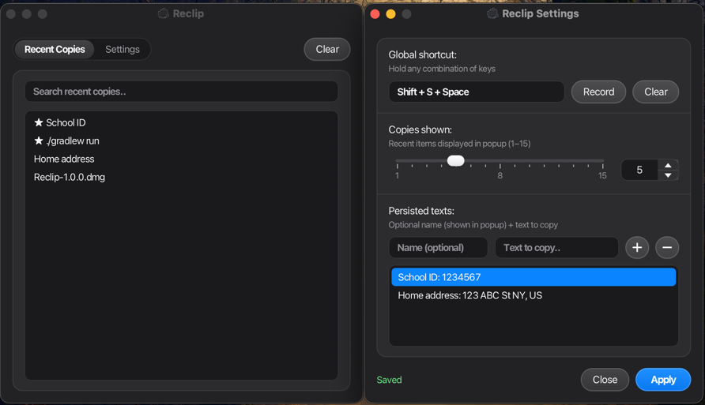
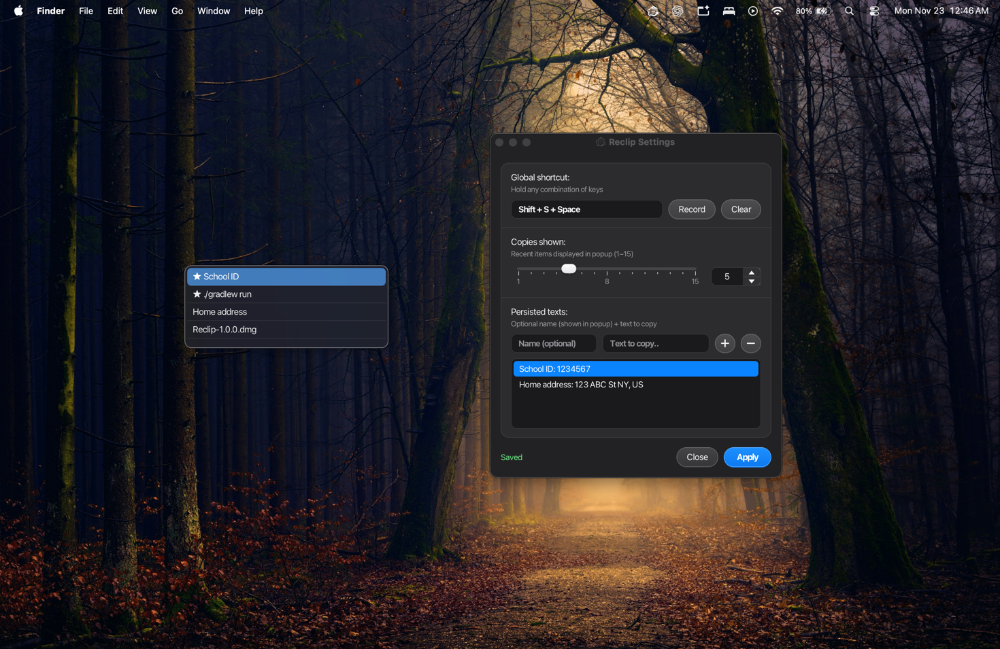

# Reclip

A local-first, privacy-focused clipboard history manager built with **Java 25** and **JavaFX 25**. Reclip runs quietly in the background, monitors text, image, and file copies, and lets you recall recent or saved snippets from a floating cursor-positioned picker or the main dashboard panel.

## Screenshots

### Main Panel & Recent Copies


### Cursor Picker & Settings


## Current Features

- **Background Clipboard Monitoring**: Quietly tracks **plain text**, **images**, and **copied files** in the background with SHA-256 deduplication and a **Pause Monitoring** toggle in the menu bar / system tray.
- **Floating Cursor Picker**: Opens right near your mouse cursor across multiple monitors using a configurable global shortcut (`Ctrl + Shift + Space` by default).
  - Navigate with `Up` / `Down` / `Home` / `End`, copy with `Enter` or click, dismiss with `Esc` or clicking outside, delete with `BackSpace` / `Delete`, and pin/unpin with `Cmd+P` (`Ctrl+P`) or right-click.
  - **Image Hover Preview**: Hovering over an `[Image]` entry reveals a `›` caret and opens a scaled-down preview popover without stealing focus.
- **Optional Auto-Paste (macOS, opt-in)**: Disabled by default; when enabled in Settings (with Accessibility permission), selecting an item in the picker restores focus to your previous app and automatically pastes (`Cmd+V`).
- **Actionable Permission Guidance**: Displays live macOS Accessibility status in Settings with **Open Settings** and **Re-check** controls, plus non-blocking warning banners if shortcuts or auto-paste lack permissions.
- **Main Dashboard & Settings**:
  - Runs as a single-instance menu-bar / system-tray app with quick access to recent copies and scrollable settings.
  - **Recent Copies** tab with live search (`Cmd+F` / `Ctrl+F`), keyboard navigation, and right-click actions (`Copy`, `Pin`/`Unpin`, `Delete`, `Clear Unpinned`).
  - **Custom Shortcut Recorder**: Set any multi-key shortcut combination.
  - **Popup Copy Limit**: Choose how many recent copies (`1–15`) appear in the floating picker.
  - **Labeled Persisted Snippets**: Save permanent snippets with optional display labels (e.g. `Home Address` copies `123 Main St`).
- **Optional Integrations**:
  - **Chrome Extension** (`extensions/chrome/`): Adds **Open Reclip Clipboard** to Chrome's right-click menu and toolbar.
  - **macOS Services** (`extensions/macos/`): Adds **Open Reclip Clipboard** to the macOS right-click **Services** menu.

## Future Features

- **Windows Auto-Paste**: Opt-in `Ctrl+V` simulation on Windows (currently implemented on macOS).
- **Windows App Exclusion Rules**: Per-app exclusion filtering on Windows (currently implemented on macOS).

## Architecture

See [docs/ARCHITECTURE.md](docs/ARCHITECTURE.md) for the full package layout, threading model, and data/privacy boundaries.

## Install (macOS)

Download **[Reclip-1.0.0.dmg](https://github.com/Kerim-Ucar/reclip/releases)**, open the `.dmg`, and drag **Reclip.app** into **Applications** (no Java or Gradle setup required).

> **macOS Permissions:** Allow Reclip under **System Settings → Privacy & Security → Accessibility** (and **Input Monitoring** if asked) so global shortcuts work. If you update the app and it asks again, remove Reclip from that list (`−`) and add it back (`+`).

## Building from Source

### Requirements

- **Java 25** (JDK 25)
- Gradle Wrapper (`./gradlew` on macOS / `.\gradlew.bat` on Windows, included)

### Running, Testing & Packaging

#### macOS

```bash
# Run unit tests
./gradlew test

# Run the application
./gradlew run

# Build build/dist/Reclip.app
./gradlew packageMacApp

# Build build/dist/Reclip-1.0.0.dmg
./gradlew packageMacDmg
```

#### Windows 10 / 11

```powershell
# Run unit tests
.\gradlew.bat test

# Run the application
.\gradlew.bat run

# Build self-contained build\dist\Reclip\Reclip.exe app image
.\gradlew.bat packageWinApp

# Build per-user Windows .exe installer (requires WiX Toolset on PATH)
.\gradlew.bat packageWinExe
```

## Testing Checklist

See [docs/TESTING_CHECKLIST.md](docs/TESTING_CHECKLIST.md) for the manual verification checklist covering macOS and Windows 10/11.

## Optional Integrations

- **Chrome Right-Click Menu (macOS & Windows)**: See [extensions/chrome/README.md](extensions/chrome/README.md).
- **macOS Services Menu**: See [extensions/macos/README.md](extensions/macos/README.md).

## Privacy & Storage

- **Local-first**: No telemetry, analytics, cloud sync, or network calls.
- **In-memory history**: Normal clipboard history is kept in memory only and cleared when you quit (session image cache files are deleted on exit).
- **Concealed & excluded apps (macOS)**: Automatically ignores `org.nspasteboard.ConcealedType` / `TransientType` secrets from password managers, plus any user-configured **Excluded apps** in Settings.
- **Encrypted local storage**: `~/.reclip/settings.properties` and optional `history.dat` are encrypted at rest with **AES-256-GCM** using a key stored in the **macOS Login Keychain** (with `0600` key-file fallback on non-Keychain systems). Use **Pause Monitoring** before copying sensitive data on unsupported platforms.

## Platform Status

- **macOS (`aarch64`)**: Built and tested on macOS with Java 25 and JavaFX 25.
- **Windows 11 (`x86_64`)**: Built and tested on Windows 11 with Java 25 and JavaFX 25 (system tray, global shortcuts, DPI-aware cursor picker, dark DWM title bars, foreground focus restoration, and `jpackage` `Reclip.exe` app image).

## License

This project is licensed under the [MIT License](LICENSE).
